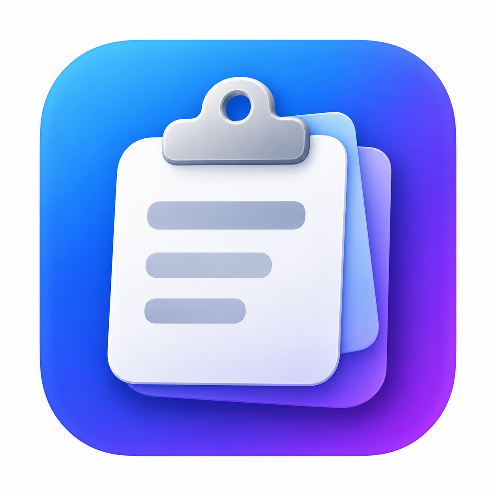
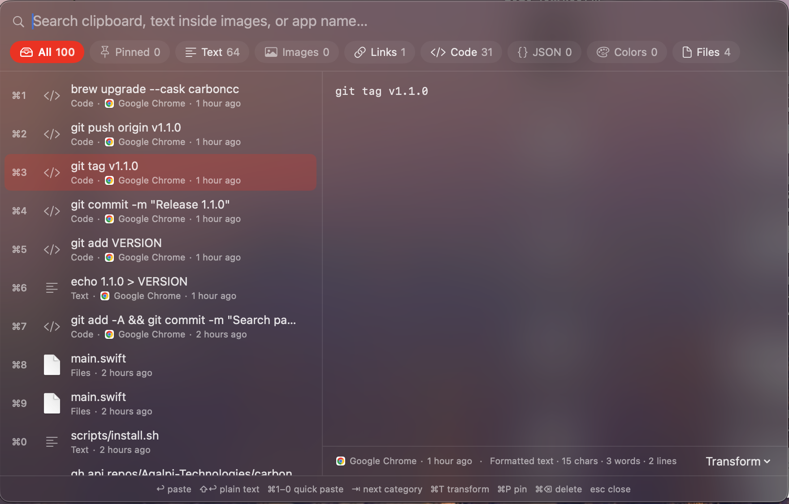

<p align="center">
  
</p>

<h1 align="center">CarbonCC</h1>

<p align="center">
  A fast, private clipboard manager that lives in your Mac's menu bar.<br>
  <b>Free and open source · Signed and notarized by Apple · Nothing leaves your Mac</b>
</p>

<p align="center">
  
</p>

---

## Install

**Homebrew**

```bash
brew install --cask aqalpi-technologies/tap/carboncc
```

**Direct download**

Download the latest `CarbonCC-x.y.z.zip` from [Releases](https://github.com/Aqalpi-Technologies/carboncc/releases/latest), unzip it and drag **CarbonCC** into **Applications**. It's signed and notarized, so it opens without security warnings.

Requires macOS 13 Ventura or later. Runs natively on Apple Silicon and Intel.

### First launch

CarbonCC pastes the item you choose straight into the app you're typing in. macOS needs your permission for that:

**System Settings → Privacy & Security → Accessibility → turn CarbonCC on.**

Without it, CarbonCC still copies the item; you just press ⌘V yourself.

## Features

- **History in the menu bar.** Everything you copy, grouped 1–10, 11–20, … up to 1,000 items.
- **Search panel (⇧⌘V).** Opens in the middle of your screen, filters as you type, with a live preview of the full text, image or files.
- **Categories.** Tabs for All, Pinned, Text, Images, Links, Code, JSON, Colors and Files. Items are sorted automatically, colors get a swatch with HEX/RGB/HSL values, and JSON is shown formatted.
- **Where and when.** Every item shows the app it was copied from and how long ago ("Safari · 5 mins ago"). You can search by app name too.
- **Text inside images.** Screenshots are scanned with Apple's on-device text recognition, so you can search for words in them and paste their text.
- **Pins.** Keep snippets you use all the time at the top, no matter how much you copy.
- **Plain-text paste.** Hold ⇧ to paste without formatting.
- **Transforms.** Paste as UPPERCASE, lowercase or Title Case; trim, join, sort or de-duplicate lines; format or minify JSON; URL- and Base64-encode or decode.
- **Images and files.** Copied screenshots and Finder files are kept with thumbnails and paste back as real images and files.
- **Password-safe.** Items marked as secret by password managers (1Password, Bitwarden, etc.) are never recorded.
- **Your way.** Choose the hotkey, history size, menu bar icon and accent color.

## Keyboard shortcuts

**Search panel** (⇧⌘V)

| Key | Action |
|---|---|
| ↑ ↓ | Move selection |
| ↩ | Paste |
| ⇧↩ | Paste as plain text |
| ⌘1 … ⌘0 | Paste item 1–10 |
| ⇥ / ⇧⇥ | Next / previous category |
| ⌘T | Transform and paste |
| ⌘P | Pin / unpin |
| ⌘⌫ | Delete item |
| esc | Close |

**Menu bar menu**

| Action | Result |
|---|---|
| Click | Paste |
| 1 … 9, 0 | Paste item 1–10 |
| ⇧ + click | Paste as plain text |
| ⌘ + click | Pin / unpin |
| ⌥ + click | Delete item |

## Privacy

CarbonCC has no network code: no accounts, analytics, telemetry or update checks. Your history is stored only on your Mac, in `~/Library/Application Support/CarbonCC/`. Clear it at any time from the menu, or delete that folder.

## Build from source

Needs Xcode Command Line Tools (`xcode-select --install`).

```bash
git clone https://github.com/Aqalpi-Technologies/carboncc.git
cd carboncc
scripts/install.sh
```

This builds the app, signs it with a local certificate (created automatically the first time), installs it to `/Applications` and launches it.

| Path | What's there |
|---|---|
| `Sources/CarbonCC/main.swift` | The whole app |
| `scripts/build.sh` | Compiles a universal `build/CarbonCC.app` |
| `scripts/install.sh` | Build, sign locally, install, launch |
| `scripts/release.sh` | Developer ID signing and notarization (maintainers) |
| `docs/RELEASING.md` | How releases are made |

## Contributing

Issues and pull requests are welcome. For larger changes, please open an issue first so we can talk about the approach.

## License

[MIT](LICENSE) © 2026 [Aqalpi Technologies](https://github.com/Aqalpi-Technologies)
